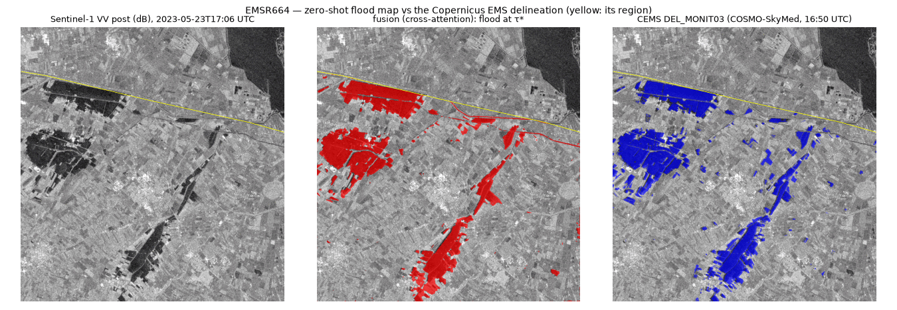
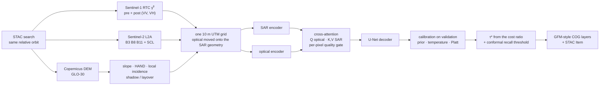

# floodfusion

**Flood maps from Sentinel-1 radar that a duty officer can act on at 03:00.** The maps are calibrated,
ship with an exclusion mask saying where they must not be trusted, and use Sentinel-2 only where it is
clear. Version 1.1 tests them on **38 flood activations mapped independently by Copernicus EMS**, with four
questions fixed in advance, and on two benchmarks with every flood held out: Sen1Floods11 (10 floods) and Kuro Siwo
(36 floods). Its main finding: **on independent maps the choice of training labels mattered, and the optical
input did not detectably.** **Version 1.2** adds a seasonal radar reference ("is this water unusual for this place
and season?"). It takes on a TerraMind trained on the same flood labels, and Copernicus's operational flood maps, in
a blind test on floods that happen after the models were frozen. It also publishes an erratum that withdraws v1.1's
TerraMind result.

[](https://github.com/teo-clerk/floodfusion/actions/workflows/ci.yml)


**[Interactive explainer](https://teo-clerk.github.io/floodfusion/)**: the project on one page, with the
radar physics, the pipeline, every result as an interactive chart, a drag-to-compare map against
Copernicus EMS, and the limits.



*Forlì, 23 May 2023: the cross-attention model, zero-shot with Sentinel-2 on 9 of 16 tiles (centre), against
Copernicus EMS's COSMO-SkyMed delineation of 21 May (right).*

## Results at a glance

### v1.2: a fair fight with TerraMind, Copernicus's own flood maps as a yardstick, and a blind test

**The idea.** Instead of asking *is this pixel water?*, v1.2's model asks *is this water unusual for this place and
season?* It reads a seasonal radar reference (the same orbit, a year earlier) beside the flood image. The
[protocol](reports/protocol_v1_2.md) was committed before any v1.2 model was trained; every rule since is in the
[deviations log](reports/v1_2_deviations.md). **[The Arena](https://teo-clerk.github.io/floodfusion/arena.html)**
puts every model on the same floods.

**What v1.2 has found so far (exploratory).**
- **v1.1's TerraMind result was a bug** ([erratum](reports/v1_1_erratum.md)). Trained as its protocol describes,
  TerraMind beats the task-specific model it lost to (0.299 vs 0.258 on 38 CEMS floods).
- **A fair TerraMind trails in cross-validation, mostly on its threshold, and nearly ties on independent maps.**
  - **The comparison:** TerraMind-base with LoRA, a pre-event image and its DEM input, against our seasonal-context
    model. Both were trained on the same flood labels: Kuro Siwo plus GEOID-Flood, 7,006 chips from 138 floods. Both
    were tuned with the same three-learning-rate budget.
  - **The result:** in grouped five-fold CV over 81 location groups, TerraMind scores 0.313 at its own threshold
    against ours at 0.394.
  - **The cause:** at the best single threshold the gap shrinks to 0.366 vs 0.388. Threshold-free, ours leads 0.651
    vs 0.617 AP. The blind test therefore requires both to favour ours. [CV table](reports/v12_pool_cv.md).
  - **On the 38 seen CEMS floods** (the frozen models, scored once after the freeze, on stacks rebuilt with the DEM
    fix): ours 0.417, TerraMind 0.405, v1.1's best 0.407 ([seen-floods analysis](reports/v12_cems_seen_tests.md)).
    - The gaps to TerraMind (+0.012 IoU, +0.015 AP) and to v1.1's best (+0.010) are small and not significant.
    - The blind test detects about 0.06 at its stopping rule, so P5 and P7 will most likely end *not supported*
      unless new floods behave differently.
- **The seasonal context helps a little.** The CV selection rule chose it (row 21) over the same model without context
  (row 9): 0.380 vs 0.361 on whole test scenes, better in 49 of 79 groups. The edge is modest and single-seed.
  [Selection](reports/v12_selection.json).
- **Per-scene self-calibration does not help** (−0.04 in CV), nor does a HAND cut (+0.001), so neither is used.
- **Copernicus GFM, the operational service**, scores 0.321 on the 34 CEMS floods it covers, against 0.419 for v1.2's
  model on the same floods.
  - **The gap:** +0.098 per activation, better on 25 of 34. It is significant at both unit definitions with the
    blind test's own analysis (descriptive: seen floods).
  - **Why GFM loses:** its likelihood ranks pixels well (AP 0.517); its fixed cut is what loses. The physics baseline
    scores 0.379 on the same floods ([preview](reports/v12_cems_preview.md)).

**The test that decides it: floods that had not happened when the models were frozen.**
- **The floods:** every eligible Copernicus EMS flood activation from EMSR899 on.
- **The models:** frozen at tag `v1.2.0-freeze`.
- **The three questions:** does v1.2's model beat
  - the fair TerraMind, at its own threshold **and** threshold-free (P5);
  - Copernicus GFM (P6);
  - v1.1's best (P7)?
- **Sealing:** scores stay sealed (sha256 in a committed ledger) until 20 activations in 15 clusters are scored, or
  31 December 2027.
- **The analysis:** written in code before the first blind flood ([`blind_analysis.py`](src/floodfusion/blind_analysis.py)).

### v1.1: four questions fixed in advance, tested on 38 Copernicus EMS flood activations

The [protocol](reports/protocol_v1_1.md) was committed before any v1.1 model was trained. Every change since is in
the [deviations log](reports/v1_1_deviations.md).

**The test set:**
- **Source:** Copernicus EMS delineations of 38 flood activations, March 2023 to March 2026.
- **The maps were drawn on non-Sentinel radar satellites** (COSMO-SkyMed, PAZ, ICEYE, RADARSAT-2, TerraSAR-X). That
  makes it the conservative test for an optical input.
- **Coverage:** 75 map/Sentinel-1 pass pairs, each within 24 h, covering 55,779 km² with 3,395 km² of mapped flood.
- **Scoring:** every model is applied zero-shot at its own calibrated threshold.
- **When a result counts:** only if it holds for single activations *and* for the 30 clusters of activations
  within 100 km and 60 days. One storm can trigger several activations, which are then not independent
  ([report](reports/cems_benchmark.md)).

| Pre-registered question | Per activation | Per cluster | Supported |
| --- | --- | --- | --- |
| **H1** Two training recipes on the same Kuro Siwo chips: *flood* labels vs *water* labels | +0.059 IoU, better in 33/38, Holm p < 0.001 | +0.062, 27/30, p < 0.001 | **yes** |
| **H4** The task-specific fusion model vs the TerraMind foundation model | +0.031, 24/38, Holm p = 0.034 | +0.039, 20/30, p = 0.009 | **yes as run; reversed by the [erratum](reports/v1_1_erratum.md)** |
| **H2** Fusion beats the SAR U-Net where optical is usable (≥ 50 % clear) | +0.038, 5/8, Holm p = 0.34, not significant | K = 7, too few | no verdict |
| **H3** Without optical (< 10 % clear), fusion is no worse than the SAR U-Net (margin 0.05) | −0.020, non-inferior (one-sided p = 0.004) | −0.024, not shown (one-sided p = 0.029 > 0.025) | no |

> **Erratum (2026-10-13): H4 is withdrawn.** TerraMind was trained without the modality dropout its config and the
> protocol state. Re-trained as described, it **beats** the fusion model on the same 38 activations: fusion −
> TerraMind = −0.042 per activation (fusion better in 10/38) and −0.043 per cluster (8/30), significant at both.
> TerraMind scores 0.299 against fusion's 0.258. This is a post-hoc correction; the pre-registered verdict is kept as
> run. A second defect (zero terrain past DEM tile edges) affected the fusion model, not TerraMind, on about 14 % of
> the benchmark's area. Rescored on stacks rebuilt with the fix, models that read terrain gain at most 0.01, and the
> reversal holds (−0.033 per activation, significant). Both are in [`reports/v1_1_erratum.md`](reports/v1_1_erratum.md).

How to read the two supported results:
- **H1** compares whole training recipes. The label changes what the sampler draws, the early stopping, the priors and
  the calibration. CEMS maps are themselves flood maps, so part of the gain is agreement of definitions. The same two
  models run without optical score 0.398 and 0.335.
- **H4** is tested on events from 2023 onwards. That is after the SSL4EO-S12 part of TerraMind's pre-training data
  (2019–2021), but TerraMind's full pre-training set (TerraMesh) runs mostly 2019–2023, so the earliest events may
  fall within its period.

**Every model on the same 38 activations:** macro IoU at each model's own threshold. Breakdowns by map type and
cloud cover are in the [strata report](reports/cems_benchmark_strata.md).

| Model | Trained on Sen1Floods11 (water drawn on optical) | Trained on Kuro Siwo (flood drawn on radar) |
| --- | --- | --- |
| U-Net, SAR only | 0.281 | 0.394 |
| Cross-attention fusion | 0.258 | **0.397** |
| The same fusion model, optical removed at inference | 0.272 | 0.398 |
| Fusion trained on *water* labels of the same Kuro Siwo chips | — | 0.338 |
| TerraMind-1.0-small, frozen + UNet decoder, as run in v1.1 | 0.226 | — |
| The same TerraMind, trained as the protocol describes ([erratum](reports/v1_1_erratum.md)) | 0.299 | — |

The physics baseline (adaptive threshold + change + terrain masks, no learning; one offset set on Sen1Floods11
validation) scores **0.371**.

**What it means:**
- **The Sen1Floods11 fusion gain is not reproduced.**
  - On Sen1Floods11 the fusion model beats the SAR U-Net by +0.26 on all ten floods.
  - On the radar-drawn CEMS maps where optical is usable, the gain is +0.04 [−0.02, +0.11]. The interval excludes
    +0.26, but a smaller gain is neither shown nor ruled out (8 activations).
  - Sen1Floods11's labels were mostly drawn on the Sentinel-2 image the model sees. Part of its gain being agreement
    with the annotators fits this, but region, years and reference type differ too.
- **Partly cloudy scenes hurt the fusion model** (descriptive).
  - On activations 10–50 % clear, the same model scores 0.254 with optical and 0.307 run without it.
  - It trails the SAR U-Net by 0.06, better on 2 of 15.
  - This fits the per-pixel failure found in [Stage A](reports/stage_a_diagnostics.md). That finding was known
    before this subset was added to the protocol (deviations log).
- **The training data moved scores more than the architecture** (descriptive).
  - The same networks score 0.39–0.40 trained on Kuro Siwo's flood labels, against 0.26–0.28 trained on
    Sen1Floods11. Switching between fusion and the SAR U-Net moves them by at most 0.03.
  - The two datasets differ in labels, places, years and size. Only H1 isolates the labels.
  - The physics baseline (0.371) beats every Sen1Floods11-trained network.
  - Trained on Kuro Siwo flood labels, the fusion model uses almost nothing from optical: 0.397 with it, 0.398
    without.
- **TerraMind's deficit was a bug.** As run, TerraMind trailed at each model's own threshold but was already ahead at
  the best single threshold (0.270 vs 0.260, chosen in-sample). It had been trained without modality dropout, so its
  SAR-only path, which most CEMS pixels need, was barely trained. Trained as described, it leads at both thresholds
  (0.299 at τ*, 0.328 at the oracle threshold).
- **Absolute agreement is modest.**
  - CEMS products are drawn on 1–3 m images up to a day from the Sentinel-1 pass, and generalised by an analyst.
  - The seven activations mapped on optical very-high-resolution images agree with every tested model at only
    0.10–0.13 IoU (indicative, K = 7).
- **No variant replaces the reference model.**
  - The pre-registered variants (gate bias, cloud augmentation, reversed attention) ran on Sen1Floods11 only; the
    12 GPU-hour cap stopped them on Kuro Siwo.
  - The best, attention with the query from SAR, gains +0.026 on 7 of 10 floods: unadjusted, single seed, no
    verdict.

**Kuro Siwo, 36 floods with labels drawn on radar,** in 29 groups of floods within 100 km, grouped five-fold
([table](reports/v11_kurosiwo_table.md); descriptive):

| Model | IoU at τ* |
| --- | --- |
| Physics baseline | 0.417 |
| Physics baseline with the event-pooled threshold fallback (2e) | 0.432 |
| 2e with the seasonal reference (2s) | 0.520 |
| U-Net, SAR only | 0.505 |
| Cross-attention fusion | 0.535 |
| The same fusion model, optical removed at inference | 0.533 |

- **Fusion vs SAR U-Net:** +0.030, better in 21 of 29 groups, not significant after Holm. Removing optical at
  inference changes the fusion model's score by only 0.002, so it barely uses the optical input.
- **The seasonal reference.** Replacing the recent pre-event reference with one from the same date a year earlier
  (2s − 2e) lifts the physics baseline:
  - by +0.087 here (17 of 29 groups);
  - by +0.175 on Sen1Floods11, almost all of it on the events that have a seasonal reference.

  On Sen1Floods11 the recent reference, 5–24 days before the image, was often already flooded (Stage A, A3), while a
  year-earlier one is dry there. On CEMS, whose recent reference was chosen to precede the activation, the seasonal
  reference does not help (0.340 vs 0.371).

### v1.0: ten Sen1Floods11 floods held out, and Forlì

**Ten real floods, each held out.** Sen1Floods11, re-ingested; leave-one-event-out — every event is
scored by a model that never saw it ([full table](reports/sen1floods11_table.md)). The v1.1 re-run at the frozen
v1.1 code replicates it ([table](reports/v11_sen1floods11_table.md)):
- fusion 0.608 against the SAR U-Net's 0.343 (+0.265, all 10 floods, Holm p = 0.018);
- TerraMind 0.572 as run; 0.597 trained as described (the erratum), still slightly below fusion here.

| Model | IoU at τ* | AP |
| --- | --- | --- |
| Global Otsu on VV | 0.299 | 0.451 |
| Physics baseline: adaptive threshold + change + terrain masks | 0.157 | 0.152 |
| Physics baseline + optical water index (MNDWI) | 0.444 | 0.440 |
| U-Net, SAR only | 0.365 | 0.538 |
| **Cross-attention fusion** (3 seeds) | **0.625** | **0.769** |
| The same fusion model with optical removed at inference | 0.383 | 0.570 |
| TerraMind-1.0-small (IBM/ESA foundation model, frozen) + UNet decoder | 0.576 | 0.765 |

- **Fusion beats the SAR-only U-Net on all 10 held-out floods**: +0.26 IoU, exact sign-flip test, Holm-adjusted
  p = 0.018. The labels were drawn on the optical image the model sees, so part of that gain is agreement
  with the annotators; the Copernicus EMS case below is the independent check.
- **Without optical, the fusion model is the SAR-only model**: −0.005 IoU, not significant, when a whole chip has
  no optical. A **partial** cloud is worse: under it the model misses almost every flooded pixel (IoU 0.03 against
  0.21 in its SAR-only mode, real cloud shapes pasted on clear chips;
  [Stage A diagnostics](reports/stage_a_diagnostics.md)). The per-pixel quality gate does not hand those pixels to
  the SAR path; only a chip with no usable optical at all falls back to it.
- **The IBM/ESA foundation model**, frozen, lands 0.05 IoU below the fusion model (behind on 7 of 10 events; not
  significant).
- **The published within-event split's flattery is unstable, and never significant.** v1.0 measured at most +0.015 IoU at τ*
  for the SAR U-Net, the fusion model and TerraMind, against +0.048 for the synthetic leakage row. The fusion
  model run without optical gains up to +0.091. None of these gaps is significant.

  The v1.1 re-run is noisier. At τ*, across seeds, the official split scores higher than leave-one-event-out by:
  - SAR U-Net: +0.02 to +0.11 (AP +0.05 to +0.11);
  - fusion model: −0.03 to +0.06;
  - TerraMind: −0.05 to +0.00.

  None is significant after Holm. One draw of this gap is not a stable estimate.
- **Conformal recall control holds on average but not per flood**: the mean per-chip miss rate is 0.08–0.11 at
  α = 0.1, but it holds on only 5–8 of 10 new floods. Events are not exchangeable.
- **Physics rules built on backscatter change fail on these labels**: in 8 of 10 events the labelled water did
  not darken against a reference up to 60 days earlier ([diagnostic](reports/sen1floods11_label_change.md)).

**Against Copernicus EMS's own maps: EMSR664, Forlì, May 2023** (zero-shot: trained on Sen1Floods11
only; [report](reports/emsr664_forli.md)). Scored on the 1101 km² that both full Sentinel-1 passes and all
four CEMS delineations (COSMO-SkyMed, RADARSAT-2, PAZ) observed, against the delineation nearest in time:

| Sentinel-1 pass | Optical | Fusion | Same model, no optical | Physics baseline |
| --- | --- | --- | --- | --- |
| 22 May (12 h after CEMS) | none | 0.390 | 0.407 | **0.577** |
| 23 May (48 h after CEMS) | 9 of 16 tiles | **0.507** | 0.230 | 0.412 |

- **Optical's value survives an independent reference.** On 23 May, Sentinel-2 adds +0.28 IoU, and the
  fusion map's flooded area (28.0 km²) matches CEMS's latest delineation (28.0 km²); without optical, the
  same model maps 94.7 km².
- **Zero-shot to the Po plain, the learned SAR-only path over-maps fields** and loses to the physics baseline
  (0.41 vs 0.58). It is not yet a drop-in SAR-only product for a new region.
- **The 18 May pass saw only the coast** (4 of 16 tiles) and is scored on its own coverage.

**Synthetic benchmark: pipeline validation, not accuracy** (13 rows × 3 seeds, 3 test basins;
[ablation](reports/ablation_table.md), [stress](reports/stress.md)).

- **The leakage row works**: a random split inflates IoU by +0.048, in all 3 test basins.
- **What does not pay off here**, reported rather than tuned away; three test basins support no significance
  verdicts:
  - fusion does not beat SAR-only (0.676 vs 0.676);
  - plain BCE beats the compound loss (0.740 vs 0.676);
  - the fusion gate barely trained, averaging 0.12–0.17 over clear sky ([gate diagnostic](reports/gate_diagnostic.md)).
- **Under wind** (0.5 → 10 m/s), the physics baseline collapses (IoU 0.74 → 0.006) while the learned models
  degrade gracefully (0.60 → 0.53).
- **Replicated at the v1.1 code** ([grid](reports/v11_ablation_table.md), [stress](reports/v11_stress.md)):
  - fusion 0.675 against SAR-only 0.675;
  - plain BCE 0.726;
  - every stress-curve point within 0.017 IoU of v1.0.

Every report names the git SHA it was produced at, and regenerates from it. The table builders refuse runs
made from different code, mixed datasets or mixed test sets.

## Why this is hard

- **The weather that floods is the weather that clouds.** Optical satellites are usually blind when it
  matters. Sentinel-1 C-band radar sees through cloud, day and night, so the map must stand on SAR.
- **SAR is ambiguous.**
  - Calm water is dark, but so are radar shadow, tarmac and dry sand.
  - Wind raises 4 cm Bragg waves and brightens open water.
  - Flooded forest and flooded streets get *brighter* (double bounce).
- **Labels disagree with each other.** A benchmark that marks *water on a date* and a Copernicus EMS map
  that marks *flood extent*, generalised from a 3 m image at another hour, are different targets.
- **Splits flatter models.** Chips from the same flood in both training and test inflate a score. The
  published Sen1Floods11 split does exactly that, and this repository measures by how much.

## How it works



- **SAR-only by construction.** The fusion is a gated residual on the SAR features,
  `F = F_s + g ⊙ Attn(Q_optical, K_SAR, V_SAR)` with `g ∈ [0, 1]` per pixel. With the gate closed the
  network *is* the SAR-only network, bit for bit. Missing optical is a learned embedding, never zeros.
  Per-sample modality dropout trains the SAR-only case.
- **Physics first.** The pipeline uses:
  - Refined Lee filtering in linear power;
  - Horn slope in a metric CRS;
  - the local incidence angle;
  - ray-swept radar shadow and layover;
  - HAND (Priority-Flood + D8);
  - a Range–Doppler geocoder with area-based radiometric terrain correction, which reproduces ESA's
    own geolocation tie points to 0.1 px.
- **A threshold that means something.** Scores are calibrated on validation, so the decision threshold
  τ* = 1/(1 + r) follows from a stated miss-to-false-alarm cost ratio r. A conformal threshold bounds
  the expected per-chip miss rate.
- **An operational product.** Seven Cloud-Optimized GeoTIFFs with the structure of the Copernicus Global
  Flood Monitoring product: flood and water extent, reference water, exclusion mask, 0–100 likelihood,
  advisory flags and the full flag field. A STAC 1.0 Item links every input scene.

## What the real data taught us

- **Sentinel-2 and Sentinel-1 are not co-registered, and the labels follow Sentinel-2.** The 2016–2019
  Sentinel-2 L2A passes sit 1–3 px (10–30 m) from the radar geometry. Uncorrected, labels drawn on them
  handicap every SAR-only model and flatter fusion. On cloudy monsoon events a label-free SWIR/SAR estimate
  has too few clear edges to measure the offset, so each event's labels and optical move by one whole-pixel
  shift taken from the labels' own water edges against the SAR when that estimate is precise. It is a
  two-parameter registration per event that uses labels, disclosed in [`DATA_CARD.md`](DATA_CARD.md) and
  checked independently in the [registration report](reports/sen1floods11_registration.md).
- **Sentinel-1A and 1B differ by 0.6 px in azimuth.** Same-satellite pairs co-register to 0.0 px.
- **Benchmark labels are not change labels.** In most Sen1Floods11 events the labelled flood shows no
  backscatter drop against a same-orbit image up to 60 days earlier
  ([diagnostic](reports/sen1floods11_label_change.md)). Change detection, the backbone of operational
  services, is structurally penalised on such labels.
- **Archives have gaps.**
  - One event's acquisition is missing from the RTC collection; the event is dropped and the reason is
    reported.
  - Another event's GRD annotation is missing; its geometry comes from an orbit model, validated
    against a real annotation (≤ 0.74° incidence error).
- **Copernicus EMS did not map this flood with Sentinel-1.** The EMSR664 delineations come from
  COSMO-SkyMed, RADARSAT-2 and PAZ at 3 m. Comparing with them compares two products at two instants.

## Reproduce

No step needs an account or an API key. The test suite and the synthetic demonstration run offline.

```bash
make setup && make preflight       # uv-locked environment (Python 3.12), environment checks
make test                          # offline suite (CPU); make test-all adds the live-service tests
make demo SEED_PROTOCOL=full       # synthetic benchmark -> 13-row ablation, 3 seeds (~1.5 h on an RTX 4060 Laptop)
make stress                        # single-factor stress curves + the fusion gate figure
make s1f11 S1F11_LEARNED="4 9 14"  # Sen1Floods11 re-ingested, leave-one-event-out + published split (~9 h)
make forli                         # EMSR664 Forlì: every Sentinel-1 pass vs every CEMS delineation
uv run python scripts/build_site.py  # the interactive explainer, from the reports -> _site/index.html
```

**v1.1** (about 45 GPU-hours on an RTX 4060 Laptop, one job at a time):

```bash
make s1f11-download s1f11-ingest s1f11-splits    # Sen1Floods11, as above
make kurosiwo-data v11-splits                    # Kuro Siwo polygons -> flood-label and water-label chips, folds
uv run --frozen python -m floodfusion.cems_benchmark prepare   # the CEMS pairs of the committed census
make seasonal                                    # year-earlier Sentinel-1 references for every stack
scripts/v11_queue.sh smoke && scripts/v11_queue.sh all          # every run, CEMS scores, tables, synthetic grid
uv run --frozen python scripts/cems_strata.py    # every CEMS model per stratum and cloud subset (the queue runs it too)
```

The CEMS census is frozen in `configs/datasets/cems_benchmark.json`. `make cems-data` re-runs it against the live
CEMS API and overwrites that file, so a reproduction should run only `prepare`. Use `uv run --frozen`: `uv.lock`
is one of the code paths the table builders check.

The TerraMind comparison (row 14) needs the optional extra: `uv sync --extra dev --extra fm`.
`docker build -t floodfusion .` gives the same locked environment; `docker run --rm floodfusion` runs
the tests. [`notebooks/walkthrough.ipynb`](notebooks/walkthrough.ipynb) walks one small event from stack
to product in about 30 s on a CPU.

## Where the map must not be used

- **Under a partial cloud.** Fusion misses most flood beneath a cloud that covers part of a scene. Remove partly
  cloudy optical altogether, so the radar path maps the scene.
- **In a new region, from a Sen1Floods11-trained model.** On independent CEMS maps those models score below the
  physics baseline; the Kuro Siwo flood-label ones do not.
- **Under dense canopy and in dense urban areas** "dry" means "not seen". These areas are flagged, not mapped.
- **Radar shadow and layover** carry no information and are excluded.
- **Wind** can hide open water.
- **Time.** The map is a snapshot at the acquisition time. It gives no depth and no damage assessment.

More in [`MODEL_CARD.md`](MODEL_CARD.md) and [`DATA_CARD.md`](DATA_CARD.md).

## Repository layout

```
src/floodfusion/
├── data/          STAC matching, archive access, the shared per-grid assembly, Sentinel-1 annotation and
│                  Range–Doppler geocoder, orbit-model geometry, Sen1Floods11, Kuro Siwo and CEMS clients,
│                  pass coverage, seasonal references, remote-input guards (http.py), chipping, dataset,
│                  the synthetic benchmark
├── models/        encoders, cross-attention fusion + gate, segmenter, ablation zoo, losses, TerraMind wrapper
├── masks.py       slope, local incidence, shadow/layover, HAND, validity flags
├── baselines.py · baseline_runner.py     the physics baseline (adaptive threshold + change + masks)
├── train.py · evaluate.py · calibration.py (incl. conformal risk control)
├── crossval.py · cv_report.py            leave-one-event-out, grouped k-fold, the published split, the protocol gap
├── cems_benchmark.py · cems_scores.py    the CEMS benchmark: census, pairs, the pre-registered tests
├── crossfit.py                           calibration across events (cross-fitted thresholds)
├── ablation.py · reporting.py · stress.py · case_study.py · products.py · predict.py
configs/           one frozen YAML per ablation row, overlays, comparisons/, event definitions
tests/             unit, integration and end-to-end tests (markers: slow, gpu, network, data)
reports/           every table above, regenerated by the make targets
assets/            the figures in this README
```

Code comments cite a design specification as `docs/NN §x`, its milestone plan as `MILESTONES.md` and
milestone codes such as `P1-M4.1`. Neither is part of this repository; the citations record which
design decision or acceptance check each piece of code implements.

## Citing

See [`CITATION.cff`](CITATION.cff). Please also cite Sen1Floods11 (Bonafilia et al., 2020) and Kuro Siwo
(Bountos et al., NeurIPS 2024 Datasets and Benchmarks) if you use their labels.

## Acknowledgements

Contains modified Copernicus Sentinel data, processed by Microsoft Planetary Computer. Copernicus EMS
products: © European Union, Copernicus Emergency Management Service. Copernicus DEM: © DLR e.V.
2010–2014 and © Airbus Defence and Space GmbH 2014–2018, provided under COPERNICUS by the European Union
and ESA. JRC Global Surface Water: EC JRC / Google. ESA WorldCover 2021. TerraMind: IBM and ESA.
Kuro Siwo annotations: Orion AI Lab, CC BY 4.0 (re-downloaded by the user; nothing is redistributed here).
Developed with AI assistance (Claude Code); the design decisions, verification and results were reviewed
by the author.

## Licence

MIT — see [`LICENSE`](LICENSE).
