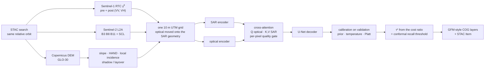

# floodfusion

**Flood maps from Sentinel-1 radar that a duty officer can act on at 03:00.** The maps are calibrated,
ship with an exclusion mask saying where they must not be trusted, and use Sentinel-2 only where it is
clear. They are tested on ten real floods, against the published benchmark split, and against Copernicus
EMS's own delineations of the 2023 Emilia-Romagna floods.

[](https://github.com/teo-clerk/floodfusion/actions/workflows/ci.yml)


## Results at a glance

TBD-RESULTS

Every number regenerates from the recorded git SHA. The table builders refuse runs made from different
code, mixed datasets or mixed test sets.

## Why this is hard

- **The weather that floods is the weather that clouds.** Optical satellites are usually blind when it
  matters. Sentinel-1 C-band radar sees through cloud, day and night, so the map must stand on SAR.
- **SAR is ambiguous.**
  - Calm water is dark, but so are radar shadow, tarmac and dry sand.
  - Wind raises 4 cm Bragg waves and brightens open water.
  - Flooded forest and flooded streets get *brighter* (double bounce).
- **Labels disagree with each other.** A benchmark that marks *water on a date* and a Copernicus EMS map
  that marks *flood extent*, generalised from a 3 m image at another hour, are different targets.
- **Splits flatter models.** Chips from the same flood in both training and test inflate a score. The
  published Sen1Floods11 split does exactly that, and this repository measures by how much.

## How it works



- **SAR-only by construction.** The fusion is a gated residual on the SAR features,
  `F = F_s + g ⊙ Attn(Q_optical, K_SAR, V_SAR)` with `g ∈ [0, 1]` per pixel. With the gate closed the
  network *is* the SAR-only network, bit for bit. Missing optical is a learned embedding, never zeros.
  Per-sample modality dropout trains the SAR-only case.
- **Physics first.** The pipeline uses:
  - Refined Lee filtering in linear power;
  - Horn slope in a metric CRS;
  - the local incidence angle;
  - ray-swept radar shadow and layover;
  - HAND (Priority-Flood + D8);
  - a Range–Doppler geocoder with area-based radiometric terrain correction, which reproduces ESA's
    own geolocation tie points to 0.1 px.
- **A threshold that means something.** Scores are calibrated on validation, so the decision threshold
  τ* = 1/(1 + r) follows from a stated miss-to-false-alarm cost ratio r. A conformal threshold bounds
  the expected per-chip miss rate.
- **An operational product.** Seven Cloud-Optimized GeoTIFFs with the structure of the Copernicus Global
  Flood Monitoring product: flood and water extent, reference water, exclusion mask, 0–100 likelihood,
  advisory flags and the full flag field. A STAC 1.0 Item links every input scene.

## What the real data taught us

- **Sentinel-2 and Sentinel-1 are not co-registered.** The 2016–2019 Sentinel-2 L2A passes sit about
  2 px (~20 m) from the radar geometry, and the Sen1Floods11 labels follow Sentinel-2 to 0.0 px.
  Uncorrected, this silently handicaps every SAR-only model. Optical and labels are moved onto the SAR
  geometry per pass, measured on SWIR/SAR structure without using labels.
- **Sentinel-1A and 1B differ by 0.6 px in azimuth.** Same-satellite pairs co-register to 0.0 px.
- **Benchmark labels are not change labels.** In most Sen1Floods11 events the labelled flood shows no
  backscatter drop against a same-orbit image up to 60 days earlier
  ([diagnostic](reports/sen1floods11_label_change.md)). Change detection, the backbone of operational
  services, is structurally penalised on such labels.
- **Archives have gaps.**
  - One event's acquisition is missing from the RTC collection; the event is dropped and the reason is
    reported.
  - Another event's GRD annotation is missing; its geometry comes from an orbit model, validated
    against a real annotation (≤ 0.74° incidence error).
- **Copernicus EMS did not map this flood with Sentinel-1.** The EMSR664 delineations come from
  COSMO-SkyMed, RADARSAT-2 and PAZ at 3 m. Comparing with them compares two products at two instants.

## Reproduce

No step needs an account or an API key. The test suite and the synthetic demonstration run offline.

```bash
make setup && make preflight       # uv-locked environment (Python 3.12), environment checks
make test                          # offline suite (CPU); make test-all adds the live-service tests
make demo SEED_PROTOCOL=full       # synthetic benchmark -> 13-row ablation, 3 seeds (~2 h on an RTX 4060 Laptop)
make stress                        # single-factor stress curves + the fusion gate figure
make s1f11 S1F11_LEARNED="4 9 14"  # Sen1Floods11 re-ingested, leave-one-event-out + published split
make forli                         # EMSR664 Forlì: every Sentinel-1 pass vs every CEMS delineation
```

The TerraMind comparison (row 14) needs the optional extra: `uv sync --extra dev --extra fm`.
`docker build -t floodfusion .` gives the same locked environment; `docker run --rm floodfusion` runs
the tests. [`notebooks/walkthrough.ipynb`](notebooks/walkthrough.ipynb) walks one small event from stack
to product in about 30 s on a CPU.

## Where the map must not be used

- **Under dense canopy and in dense urban areas** "dry" means "not seen". These areas are flagged, not mapped.
- **Radar shadow and layover** carry no information and are excluded.
- **Wind** can hide open water.
- **Time.** The map is a snapshot at the acquisition time. It gives no depth and no damage assessment.

More in [`MODEL_CARD.md`](MODEL_CARD.md) and [`DATA_CARD.md`](DATA_CARD.md).

## Repository layout

```
src/floodfusion/
├── data/          STAC matching, archive access, the shared per-grid assembly, Sentinel-1 annotation and
│                  Range–Doppler geocoder, orbit-model geometry, Sen1Floods11 and CEMS clients,
│                  remote-input guards (http.py), chipping, dataset, the synthetic benchmark
├── models/        encoders, cross-attention fusion + gate, segmenter, ablation zoo, losses, TerraMind wrapper
├── masks.py       slope, local incidence, shadow/layover, HAND, validity flags
├── baselines.py · baseline_runner.py     the physics baseline (adaptive threshold + change + masks)
├── train.py · evaluate.py · calibration.py (incl. conformal risk control)
├── crossval.py · cv_report.py            leave-one-event-out, the published split, the protocol gap
├── ablation.py · reporting.py · stress.py · case_study.py · products.py · predict.py
configs/           one frozen YAML per ablation row, overlays, comparisons/, event definitions
tests/             unit, integration and end-to-end tests (markers: slow, gpu, network, data)
reports/           every table above, regenerated by the make targets
assets/            the figures in this README
```

Code comments cite a design specification as `docs/NN §x`, its milestone plan as `MILESTONES.md` and
milestone codes such as `P1-M4.1`. Neither is part of this repository; the citations record which
design decision or acceptance check each piece of code implements.

## Citing

See [`CITATION.cff`](CITATION.cff). Please also cite Sen1Floods11 (Bonafilia et al., 2020) if you use
its labels.

## Acknowledgements

Contains modified Copernicus Sentinel data, processed by Microsoft Planetary Computer. Copernicus EMS
products: © European Union, Copernicus Emergency Management Service. Copernicus DEM: © DLR e.V.
2010–2014 and © Airbus Defence and Space GmbH 2014–2018, provided under COPERNICUS by the European Union
and ESA. JRC Global Surface Water: EC JRC / Google. ESA WorldCover 2021. TerraMind: IBM and ESA.
Developed with AI assistance (Claude Code); the design decisions, verification and results were reviewed
by the author.

## Licence

MIT — see [`LICENSE`](LICENSE).
