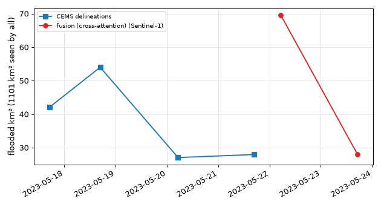

# EMSR664 AOI 1 — every Sentinel-1 pass against CEMS's own delineations

Zero-shot: the models were trained on Sen1Floods11 only; τ* and the prior correction come from its validation set and need not transfer to this scene, so each learned cell shows **IoU at τ* / IoU at the oracle threshold** (the latter is not deployable; the gap between them is the threshold transfer). Inputs from Planetary Computer; the pre-event reference is forced before 2023-05-01 (the region had flooded on 2-3 May as well). A product's region is its AOI inside the footprints of the images its polygons came from, minus 'not analysed'. Scored on valid SAR pixels outside permanent water. CEMS products: © European Union, Copernicus Emergency Management Service.

## CEMS products

| Product | Sensor | Acquired (UTC) | Region observed | Flood in it |
| --- | --- | --- | --- | --- |
| DEL_PRODUCT | COSMO-SkyMed | 2023-05-17T17:14 | 1982 km² | 88.0 km² |
| DEL_MONIT01 | RADARSAT-2 | 2023-05-18T16:55 | 2143 km² | 112.1 km² |
| DEL_MONIT02 | PAZ | 2023-05-20T05:19 | 3204 km² | 87.7 km² |
| DEL_MONIT03 | COSMO-SkyMed | 2023-05-21T16:50 | 1315 km² | 44.8 km² |

## IoU, pass × product, on the region common to every full-coverage pass and every product (nearest product in time in **bold**)

**fusion (cross-attention)**

| Pass | Optical tiles | DEL_PRODUCT | DEL_MONIT01 | DEL_MONIT02 | DEL_MONIT03 |
| --- | --- | --- | --- | --- | --- |
| S1_20230518T1658_o044 | 0/4 | — | **—** | — | — |
| S1_20230522T0519_o095 | 0/16 | 0.076 / 0.077 (+108 h) | 0.138 / 0.139 (+84 h) | 0.218 / 0.226 (+48 h) | **0.390 / 0.419 (+12 h)** |
| S1_20230523T1706_o117 | 9/16 | 0.043 / 0.049 (+144 h) | 0.120 / 0.127 (+120 h) | 0.253 / 0.254 (+84 h) | **0.507 / 0.509 (+48 h)** |

**fusion, SAR only**

| Pass | Optical tiles | DEL_PRODUCT | DEL_MONIT01 | DEL_MONIT02 | DEL_MONIT03 |
| --- | --- | --- | --- | --- | --- |
| S1_20230518T1658_o044 | 0/4 | — | **—** | — | — |
| S1_20230522T0519_o095 | 0/16 | 0.075 / 0.077 (+108 h) | 0.136 / 0.139 (+84 h) | 0.223 / 0.226 (+48 h) | **0.407 / 0.418 (+12 h)** |
| S1_20230523T1706_o117 | 9/16 | 0.068 / 0.070 (+144 h) | 0.108 / 0.109 (+120 h) | 0.143 / 0.145 (+84 h) | **0.230 / 0.237 (+48 h)** |

**physics baseline (row 2)** (a 0/1 rule: IoU at its operating offset)

| Pass | Optical tiles | DEL_PRODUCT | DEL_MONIT01 | DEL_MONIT02 | DEL_MONIT03 |
| --- | --- | --- | --- | --- | --- |
| S1_20230518T1658_o044 | 0/4 | — | **—** | — | — |
| S1_20230522T0519_o095 | 0/16 | 0.126 (+108 h) | 0.337 (+84 h) | 0.525 (+48 h) | **0.577 (+12 h)** |
| S1_20230523T1706_o117 | 9/16 | 0.100 (+144 h) | 0.284 (+120 h) | 0.419 (+84 h) | **0.412 (+48 h)** |

## IoU, pass × product, on each pass's own coverage (nearest product in time in **bold**)

**fusion (cross-attention)**

| Pass | Optical tiles | DEL_PRODUCT | DEL_MONIT01 | DEL_MONIT02 | DEL_MONIT03 |
| --- | --- | --- | --- | --- | --- |
| S1_20230518T1658_o044 | 0/4 | 0.030 / 0.045 (+24 h) | **0.075 / 0.098 (+0 h)** | 0.039 / 0.047 (-36 h) | — |
| S1_20230522T0519_o095 | 0/16 | 0.076 / 0.077 (+108 h) | 0.138 / 0.139 (+84 h) | 0.218 / 0.226 (+48 h) | **0.390 / 0.419 (+12 h)** |
| S1_20230523T1706_o117 | 9/16 | 0.043 / 0.049 (+144 h) | 0.120 / 0.127 (+120 h) | 0.253 / 0.254 (+84 h) | **0.507 / 0.509 (+48 h)** |

**fusion, SAR only**

| Pass | Optical tiles | DEL_PRODUCT | DEL_MONIT01 | DEL_MONIT02 | DEL_MONIT03 |
| --- | --- | --- | --- | --- | --- |
| S1_20230518T1658_o044 | 0/4 | 0.032 / 0.055 (+24 h) | **0.081 / 0.097 (+0 h)** | 0.041 / 0.047 (-36 h) | — |
| S1_20230522T0519_o095 | 0/16 | 0.075 / 0.077 (+108 h) | 0.136 / 0.139 (+84 h) | 0.223 / 0.225 (+48 h) | **0.407 / 0.418 (+12 h)** |
| S1_20230523T1706_o117 | 9/16 | 0.068 / 0.070 (+144 h) | 0.108 / 0.109 (+120 h) | 0.143 / 0.145 (+84 h) | **0.230 / 0.237 (+48 h)** |

**physics baseline (row 2)** (a 0/1 rule: IoU at its operating offset)

| Pass | Optical tiles | DEL_PRODUCT | DEL_MONIT01 | DEL_MONIT02 | DEL_MONIT03 |
| --- | --- | --- | --- | --- | --- |
| S1_20230518T1658_o044 | 0/4 | 0.031 (+24 h) | **0.228 (+0 h)** | 0.146 (-36 h) | — |
| S1_20230522T0519_o095 | 0/16 | 0.126 (+108 h) | 0.337 (+84 h) | 0.524 (+48 h) | **0.577 (+12 h)** |
| S1_20230523T1706_o117 | 9/16 | 0.100 (+144 h) | 0.284 (+120 h) | 0.419 (+84 h) | **0.412 (+48 h)** |

## Scored area and flood prevalence per pass (own coverage, nearest product)

| Pass | Nearest product | Scored km² | CEMS flood prevalence |
| --- | --- | --- | --- |
| S1_20230518T1658_o044 | DEL_MONIT01 | 133 | 0.016 |
| S1_20230522T0519_o095 | DEL_MONIT03 | 1303 | 0.035 |
| S1_20230523T1706_o117 | DEL_MONIT03 | 1303 | 0.035 |

## Flooded area on the region every full-coverage pass and every product observed (recession)

| Map | Time (UTC) | Flooded km² |
| --- | --- | --- |
| CEMS DEL_PRODUCT (COSMO-SkyMed) | 2023-05-17T17:14 | 42.1 |
| CEMS DEL_MONIT01 (RADARSAT-2) | 2023-05-18T16:55 | 54.0 |
| CEMS DEL_MONIT02 (PAZ) | 2023-05-20T05:19 | 27.1 |
| CEMS DEL_MONIT03 (COSMO-SkyMed) | 2023-05-21T16:50 | 28.0 |
| fusion (cross-attention), S1_20230522T0519_o095 | 2023-05-22T05:19 | 69.5 |
| fusion, SAR only, S1_20230522T0519_o095 | 2023-05-22T05:19 | 63.7 |
| physics baseline (row 2), S1_20230522T0519_o095 | 2023-05-22T05:19 | 19.5 |
| fusion (cross-attention), S1_20230523T1706_o117 | 2023-05-23T17:06 | 28.0 |
| fusion, SAR only, S1_20230523T1706_o117 | 2023-05-23T17:06 | 94.7 |
| physics baseline (row 2), S1_20230523T1706_o117 | 2023-05-23T17:06 | 16.3 |

Common region: 1101 km² (valid SAR on every full-coverage pass, observed by every CEMS product). Passes that covered part of the AOI are scored on their own coverage only: S1_20230518T1658_o044.

