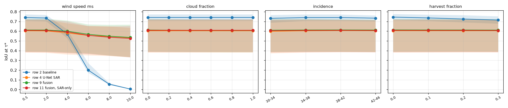
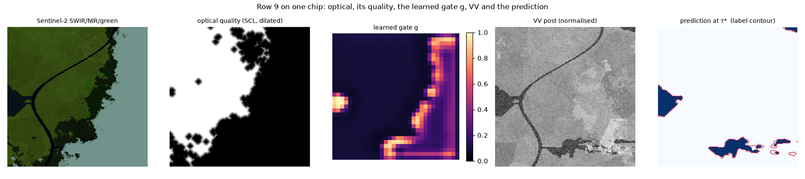

# Stress test — one physical factor at a time (synthetic, unseen landscapes)

Landscape seeds 9101, 9202, 9303, 9404, 9505 (no training event used them); every other parameter fixed. IoU at each model's calibrated operating point τ*; the baseline at its validation-chosen offset. Each cell: mean over the five landscapes [min, max]. One trained model per row (seed 42).

## wind speed ms

| value | row 2 baseline | row 4 U-Net SAR | row 9 fusion | row 11 fusion, SAR-only |
| --- | --- | --- | --- | --- |
| 0.5 | 0.740 [0.71, 0.77] | 0.604 [0.38, 0.72] | 0.612 [0.39, 0.72] | 0.608 [0.38, 0.72] |
| 2.0 | 0.735 [0.70, 0.77] | 0.602 [0.38, 0.71] | 0.612 [0.39, 0.73] | 0.607 [0.38, 0.72] |
| 4.0 | 0.570 [0.53, 0.62] | 0.581 [0.36, 0.68] | 0.600 [0.38, 0.71] | 0.592 [0.37, 0.70] |
| 6.0 | 0.200 [0.17, 0.27] | 0.556 [0.35, 0.65] | 0.568 [0.37, 0.67] | 0.557 [0.36, 0.65] |
| 8.0 | 0.055 [0.05, 0.07] | 0.547 [0.34, 0.65] | 0.548 [0.35, 0.66] | 0.537 [0.35, 0.65] |
| 10.0 | 0.006 [0.00, 0.01] | 0.533 [0.33, 0.63] | 0.536 [0.33, 0.67] | 0.525 [0.33, 0.65] |

## cloud fraction

| value | row 2 baseline | row 4 U-Net SAR | row 9 fusion | row 11 fusion, SAR-only |
| --- | --- | --- | --- | --- |
| 0.0 | 0.740 [0.71, 0.77] | 0.604 [0.38, 0.72] | 0.612 [0.39, 0.73] | 0.608 [0.38, 0.72] |
| 0.2 | 0.740 [0.71, 0.77] | 0.604 [0.38, 0.72] | 0.610 [0.39, 0.72] | 0.608 [0.38, 0.72] |
| 0.4 | 0.740 [0.71, 0.77] | 0.604 [0.38, 0.72] | 0.609 [0.39, 0.72] | 0.608 [0.38, 0.72] |
| 0.6 | 0.740 [0.71, 0.77] | 0.604 [0.38, 0.72] | 0.608 [0.38, 0.72] | 0.608 [0.38, 0.72] |
| 0.8 | 0.740 [0.71, 0.77] | 0.604 [0.38, 0.72] | 0.608 [0.38, 0.72] | 0.608 [0.38, 0.72] |
| 1.0 | 0.740 [0.71, 0.77] | 0.604 [0.38, 0.72] | 0.608 [0.38, 0.72] | 0.608 [0.38, 0.72] |

## incidence

| value | row 2 baseline | row 4 U-Net SAR | row 9 fusion | row 11 fusion, SAR-only |
| --- | --- | --- | --- | --- |
| 30-34 | 0.732 [0.69, 0.77] | 0.598 [0.37, 0.71] | 0.610 [0.39, 0.72] | 0.605 [0.38, 0.72] |
| 34-38 | 0.740 [0.71, 0.77] | 0.604 [0.38, 0.72] | 0.612 [0.39, 0.73] | 0.608 [0.38, 0.72] |
| 38-42 | 0.740 [0.71, 0.77] | 0.606 [0.38, 0.71] | 0.613 [0.39, 0.72] | 0.609 [0.38, 0.72] |
| 42-46 | 0.734 [0.70, 0.76] | 0.605 [0.38, 0.71] | 0.612 [0.39, 0.72] | 0.608 [0.38, 0.71] |

## harvest fraction

| value | row 2 baseline | row 4 U-Net SAR | row 9 fusion | row 11 fusion, SAR-only |
| --- | --- | --- | --- | --- |
| 0.0 | 0.744 [0.71, 0.78] | 0.605 [0.38, 0.72] | 0.613 [0.39, 0.72] | 0.609 [0.38, 0.72] |
| 0.1 | 0.736 [0.70, 0.77] | 0.604 [0.38, 0.72] | 0.612 [0.39, 0.72] | 0.608 [0.38, 0.72] |
| 0.2 | 0.725 [0.69, 0.76] | 0.604 [0.38, 0.71] | 0.612 [0.39, 0.72] | 0.608 [0.38, 0.72] |
| 0.3 | 0.714 [0.68, 0.75] | 0.604 [0.38, 0.71] | 0.611 [0.39, 0.72] | 0.607 [0.38, 0.72] |

